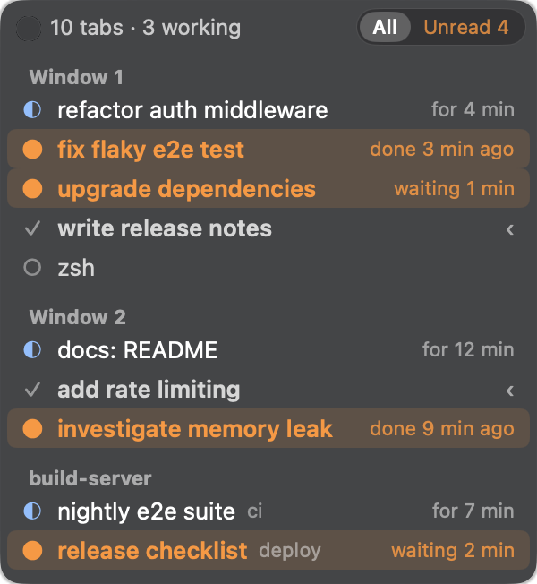

# GhosttyBar

(Disclaimer: fully vibe coded)

A vertical tab list for [Ghostty](https://ghostty.org) in your macOS menu bar, showing which
[Claude Code](https://docs.anthropic.com/en/docs/claude-code) sessions are working, finished, or waiting for you.


## Why

If you run several Claude Code sessions in Ghostty tabs, you end up clicking through tabs to see
which one is done and which one is still working. GhosttyBar shows all tabs in one list, marks the
ones that finished or rang the bell while you were looking elsewhere, and takes you there in one click.
Use it from the menu bar, from a small floating window, or with a global hotkey.

## Features

- All Ghostty tabs from all windows in one list, grouped by window.
- Claude Code status for each tab: working (with elapsed time), finished, or waiting for input.
- **Unread** tracking: a tab that finishes or rings the bell while you are not looking at it stays
  marked until you look at it. Marks survive a restart of GhosttyBar.
- Menu bar title shows `≡`, or `● 3` when three tabs are unread.
- Optional floating window with an `All | Unread` filter, adjustable transparency and blur.
- Click a tab (in the menu or the window) to jump to it.
- Global hotkey ⌃⌥J jumps to the oldest unread tab, from any app.
- Optional macOS notification when a tab finishes. Off by default.
- **External sources**: list agent sessions from tmux, other machines or bots next to your Ghostty tabs,
  through any command that prints a small JSON list.
- Demo mode with sample tabs, so you can try it without Ghostty.
- Native Swift, about 2,200 lines, no dependencies. GhosttyBar itself makes no network connections.

| Unread filter | Menu bar dropdown |
| --- | --- |
|  |  |

## Requirements

- macOS 14 (Sonoma) or later, Apple silicon or Intel.
- Ghostty 1.4 or later. GhosttyBar reads tabs through Ghostty's AppleScript dictionary, which is on
  by default (`macos-applescript = true`).
- On first run macOS asks whether GhosttyBar may control Ghostty. Click **Allow**. Without this
  permission GhosttyBar shows "No tabs".

## Install

### Build from source (recommended)

You need Swift 6, which comes with Xcode 16 or later or the Xcode command line tools (`xcode-select --install`).
With the command line tools 27, swiftc cannot compile SwiftUI's `@State` against the macOS 27 SDK,
because the tools do not ship the SwiftUI macro plugin. `build.sh` then builds with the newest installed
SDK where `@State` compiles, for example `MacOSX26.5.sdk`.

```sh
git clone https://github.com/tony-schumacher/ghostty-bar.git
cd ghostty-bar
make install   # builds, copies GhosttyBar.app to ~/Applications and starts it
```

Other targets:

```sh
make build     # build/GhosttyBar.app (universal: arm64 + x86_64)
make run       # build and run in the foreground, log to the terminal
make demo      # build and run with sample tabs
make zip       # dist/GhosttyBar-<version>.zip
make clean
```

`make install` quits a running GhosttyBar before it replaces it.

### Download a release

Download the zip from the [releases page](https://github.com/tony-schumacher/ghostty-bar/releases),
unzip it and move `GhosttyBar.app` to `~/Applications` or `/Applications`.

The app is ad-hoc signed, not notarized, so macOS blocks it the first time. Either right-click the app
and choose **Open**, or allow it under System Settings → Privacy & Security → **Open Anyway**,
or remove the quarantine flag:

```sh
xattr -dr com.apple.quarantine ~/Applications/GhosttyBar.app
```

To start it with your Mac, turn on **Launch at Login** in the menu.

## Usage

Click `≡` in the menu bar. The dropdown lists every tab; click one to jump to it.
**Show window** opens the floating window, which lists the same tabs.

### What the symbols mean

| Symbol | Status | Detail text |
| --- | --- | --- |
| ◐ (blue) | Claude is working | `for 4 min` |
| ● (orange) | Unread: finished, or rang the bell, while you were not looking | `just finished`, `done 3 min ago`, `waiting 1 min` |
| ✓ | Claude is idle and you have seen it | |
| ○ | Not a Claude Code tab (a plain shell, an editor, ...) | |
| ‹ | The selected tab of its Ghostty window | |

`waiting` means the tab rang the bell, which Claude Code does when it needs your input or a permission.

### When a tab counts as read

A tab is marked read when it is the tab you are looking at (Ghostty is the active app, its window is in
front, the tab is selected) for 0.6 seconds. Quickly cycling through tabs with ⌘⇧[ and ⌘⇧] does not
mark them read. Jumping to a tab through GhosttyBar marks it read right away. **Mark all as read**
clears all marks.

If you are looking at a tab when it finishes, it does not become unread.

### Hotkey

⌃⌥J jumps to the next unread tab, oldest first. It works from any app and needs no Accessibility
permission. If it clashes with another app, turn off **Global hotkey ⌃⌥J** in the menu. If another app
already owns the combination, the item reads "(unavailable)". Click it to try again: if ⌃⌥J is still
taken, the setting turns off. Turn it back on once the other app lets go.

### Settings

All settings are in the menu bar dropdown. Right-click the floating window for the same display and
behavior settings plus **Hide window**.

| Setting | What it does |
| --- | --- |
| Show / Hide window | Floating tab window. Drag it anywhere; drag its edge to change the width. The height follows the number of tabs. |
| Show unread only | Same as the All / Unread filter in the window. |
| Always on top | Keeps the window above other windows and on all Spaces. On by default. |
| Transparency | Opacity of the window background: 100 % is solid, 15 % is almost clear. Default 85 %. |
| Blur | Blur of what shows through the window, from off to 100 %. Until you set it, it follows Transparency. |
| Notify when done | A silent macOS notification when a tab becomes unread. Click it to jump to the tab. Off by default. If notifications are turned off for GhosttyBar in System Settings, the item says so and opens that page. |
| Global hotkey ⌃⌥J | See above. On by default. |
| Launch at Login | Starts GhosttyBar when you log in. |

Frosted (Transparency 40 %, Blur 75 %) and see-through (Transparency 25 %, Blur off):

| Frosted | See-through |
| --- | --- |
|  |  |

Settings are stored in the `com.github.tony-schumacher.GhosttyBar` defaults domain. To reset everything:

```sh
defaults delete com.github.tony-schumacher.GhosttyBar
defaults delete com.github.tony-schumacher.GhosttyBar.demo 2>/dev/null  # only if a demo was killed hard
```

To toggle the window from a script or a keyboard tool, send the `USR1` signal:

```sh
pkill -USR1 -x GhosttyBar
```

### Demo mode

```sh
make demo
# or
build/GhosttyBar.app/Contents/MacOS/GhosttyBar --demo
```

Demo mode shows eight sample tabs in two windows plus a sample external source (`build-server`) and never
talks to Ghostty or runs any source command. It uses separate settings
that are removed when the demo quits (Quit, Ctrl-C or `kill`), logs only to the terminal, registers no
hotkey, posts no notifications and never adds itself as a login item (those menu items are shown but do
nothing), so it can run next to your normal GhosttyBar. All screenshots on this page are from demo mode;
`kill -USR2` opens the demo's dropdown so it can be captured from a script.

## External sources

GhosttyBar can also list sessions that don't live in a Ghostty tab: Claude Code in tmux on a build server,
an agent on another Mac, a chat bot waiting for an answer. You connect them with a small command that prints
JSON. Each source becomes its own group after the Ghostty windows, with the same unread tracking, filter,
hotkey, notifications and menu bar count.



### Config

Create `~/.config/ghosttybar/sources.json`:

```json
{
  "sources": [
    { "name": "build-server", "command": "~/bin/tmux-source.sh me@build-server", "interval": 5, "timeout": 4 },
    { "name": "local tmux", "command": "~/bin/tmux-source.sh" }
  ]
}
```

| Field | Meaning |
| --- | --- |
| `name` | Group header in the list. Must be unique. |
| `command` | Run with `/bin/sh -c`, so pipes, `~` and arguments work. `/opt/homebrew/bin` and `/usr/local/bin` are added to `PATH`. |
| `interval` | Seconds between runs. Default 5, minimum 2. |
| `timeout` | Seconds before the command is killed and the source shows as timed out. Default 4. |

GhosttyBar picks up changes to the file within a few seconds, no restart needed. An invalid file is logged
and ignored (the previous sources keep running). Without the file, nothing runs. To try a config without
touching your normal setup, run the demo with it: `GHOSTTYBAR_SOURCES=./sources.json make demo`.

### Command output

The command prints one JSON object on stdout and exits 0:

```json
{
  "items": [
    { "id": "build", "title": "fix flaky test", "state": "busy", "since": 1794200000, "subtitle": "ci" },
    { "id": "deploy", "title": "release checklist", "state": "waiting", "url": "https://example.com/deploy/42" }
  ],
  "error": null
}
```

| Field | Required | Meaning |
| --- | --- | --- |
| `id` | yes | Stable id of the item within this source (string or number). Read state is tracked by it. |
| `title` | yes | Row text. |
| `state` | yes | `busy` (working), `idle` (done), `waiting` (needs you now), `plain` (no agent status). |
| `since` | no | Unix seconds. For `busy` when it started (shows `for 4 min`), for `idle` / `waiting` when it finished. |
| `subtitle` | no | Dim text after the title, e.g. the machine or channel. |
| `url` | no | Opened when you click the item (any URL macOS can open: `https:`, `ssh:`, an app's own scheme). |
| `error` | no | A non-empty string marks the source offline and shows the message in the group header. |

How items become unread:

- `busy` → `idle` or `waiting`: finished, unread (like a Ghostty tab).
- `waiting` on first sight, or after any other state: unread right away (like the bell).
- An item becomes read when you click it (then its `url` opens), when it turns `busy` again, or with
  **Mark all as read**. GhosttyBar can't see you looking at another machine, so there is no "looked at"
  rule for external items. **Next unread tab** (⌃⌥J) marks the item read and opens its `url`, if it has one.
- The last state of every item is kept across restarts of GhosttyBar, so a session that finished while
  GhosttyBar was not running still shows up as unread.

When the command fails, times out or prints something that isn't valid JSON, the group header shows
`<name> · offline` (or `timed out`, or the `error` text) and the last known items stay in the list, dimmed.
Details go to the log. A slow or broken source never blocks the app: each command runs in the background,
at most one run per source at a time.

### Example: Claude Code in tmux, local or over ssh

[`examples/tmux-source.sh`](examples/tmux-source.sh) lists the tmux panes that run Claude Code, with the
state taken from the pane title (the same glyphs GhosttyBar reads from Ghostty). Copy it somewhere and use it
as a source:

```sh
cp examples/tmux-source.sh ~/bin/ && chmod +x ~/bin/tmux-source.sh
~/bin/tmux-source.sh                  # tmux on this Mac
~/bin/tmux-source.sh me@build-server  # tmux on another machine, over ssh
~/bin/tmux-source.sh --all            # also panes that don't run Claude Code
~/bin/tmux-source.sh -L work          # a tmux server started with `tmux -L work`
```

For a remote machine you need key-based ssh login (the script uses `BatchMode`, so it never prompts). The
first run opens a shared ssh connection (`ControlMaster`, kept for 10 minutes), so polling every few seconds
reuses it instead of doing a new handshake each time. A window whose bell flag is set counts as `waiting`.
The script needs only `sh`, `awk` and `tmux`, and always prints valid JSON, with problems in `error`.

### Writing your own source

Any language works, as long as the command prints the JSON above and returns within the timeout. Some ideas:
a bot that writes its state to a file (`cat ~/.agent/state.json`), a `curl` to a status endpoint, a query
over ssh. Keep it fast: it runs every few seconds.

## How it works

Claude Code puts a status glyph at the start of the terminal title, and Ghostty adds 🔔 to the title when
a tab rings the bell. GhosttyBar reads the titles of all tabs through Ghostty's AppleScript interface:

| Title starts with | Meaning |
| --- | --- |
| ◐ ◑ ◒ ◓ or a braille spinner (⠂ ⠐ ...) | working |
| ✳ ✻ ✽ ✶ ✢ | idle |
| 🔔 | the bell rang (needs input) |

A tab that goes from working to idle becomes unread unless you are looking at it.

- GhosttyBar polls every 0.7 seconds while Ghostty is the active app (to notice quickly that you looked at
  a tab) and every 2 seconds otherwise. The AppleScript calls run on a background queue.
- It only polls while Ghostty is running, so it never launches Ghostty.
- It makes no network connections. Everything stays on your Mac. External source commands are yours: they
  do whatever you configure, GhosttyBar only runs them and reads their output.
- Any tool that sets the same title glyphs works too, not only Claude Code.

## Caveats

- The blur radius and the rounded window shape use two private macOS APIs (`CGSSetWindowBackgroundBlurRadius`
  and the window's corner mask), the same kind of call terminals use for their own background blur. If a
  future macOS removes them, the window still works, without blur or with square corners.
- Notifications may not be available for ad-hoc signed builds. The menu item then reads
  "(off in System Settings)" or the setting stays off.
- Because each build has a new ad-hoc signature, macOS may ask again for permission to control Ghostty
  after you rebuild.
- Tab status comes from the title. If you or a shell prompt overwrite the title, GhosttyBar shows a plain tab.

## Troubleshooting

**"No tabs" although Ghostty is open.** GhosttyBar probably lacks the Automation permission. Check
System Settings → Privacy & Security → Automation → GhosttyBar → Ghostty, or reset the permission and
start GhosttyBar again to get the prompt back:

```sh
tccutil reset AppleEvents com.github.tony-schumacher.GhosttyBar
```

**Where is the log?** When started from a terminal (`make run`), GhosttyBar logs to the terminal.
Otherwise it writes to `~/Library/Logs/GhosttyBar.log`, which starts over once it passes 1 MB.

**The hotkey does nothing.** Check that **Global hotkey ⌃⌥J** is checked and not marked "(unavailable)".
It only acts when at least one tab is unread.

## Contributing

Small pull requests are welcome: bug fixes, support for more title glyphs, better defaults. Please keep it
small and dependency-free. `make build` must stay free of warnings; CI builds with `STRICT=1 ./build.sh`,
which treats warnings as errors. For larger changes, open an issue first.

Releases: bump `VERSION` and `CHANGELOG.md`, then push a tag `v<version>`. The release workflow builds
the zip and attaches it to a GitHub release.

## License

[MIT](LICENSE) © Tony Schumacher
